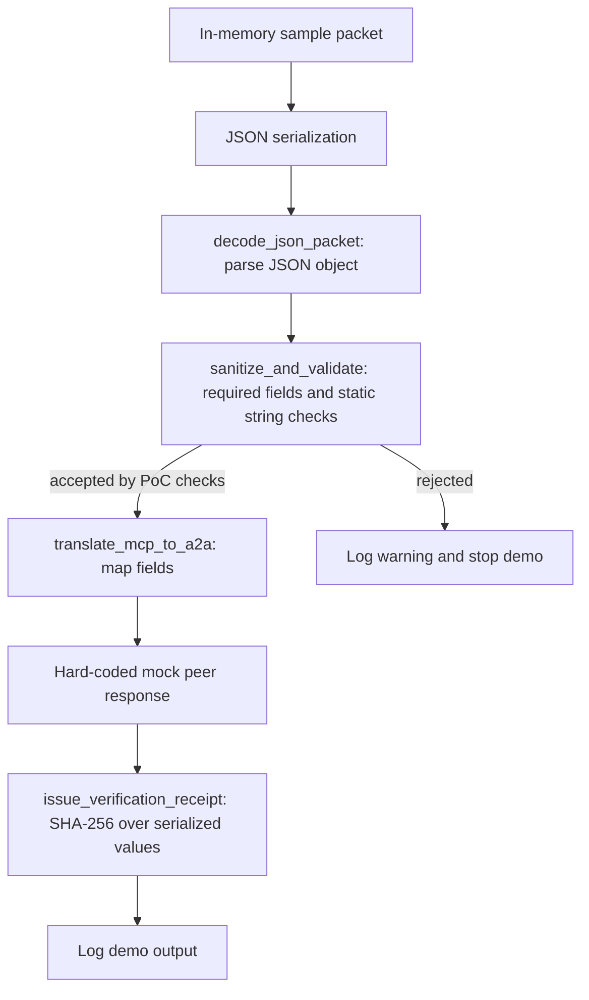

# NAN AI2AI Bridge PoC Architecture

## Scope

This document describes the runnable example in `examples/01-hello-agent/hello_bridge.py`. It runs locally with an in-memory sample packet and a hard-coded mock response. It does not connect two agents, expose a network service, or implement a production protocol.

## Implemented data flow

The JSON decoder rejects malformed JSON, non-text input, and top-level JSON values that are not objects. The validator checks a small set of required fields and static string patterns. These checks are illustrative and do not provide security validation. The response is created inside the demo; no remote agent executes the task. The receipt contains a SHA-256 digest that can detect changes to the values hashed, but does not establish who produced them, whether a remote action occurred, or whether the result is trustworthy.

## Conceptual protocol layers

The following terms describe possible future design areas only. They are not implemented protocol layers in this repository:

- **Discovery — conceptual:** no agent registry, capability discovery, or peer lookup exists.
- **Negotiation — conceptual:** no protocol/version negotiation, consent exchange, or task agreement exists.
- **Verification — conceptual:** no independent result verification, digital signature, identity proof, or remote execution attestation exists. The demo's SHA-256 receipt is only a local digest over its inputs.

## Current limitations

- No network transport, authentication, authorization, replay protection, timeouts, or persistent state.
- Static substring checks can miss attacks and can reject benign text; they are not a security boundary.
- No formal JSON Schema, cryptographic signature, key management, or independent test of peer claims.
- The example and its tests demonstrate limited local behavior only. They do not establish production readiness.
