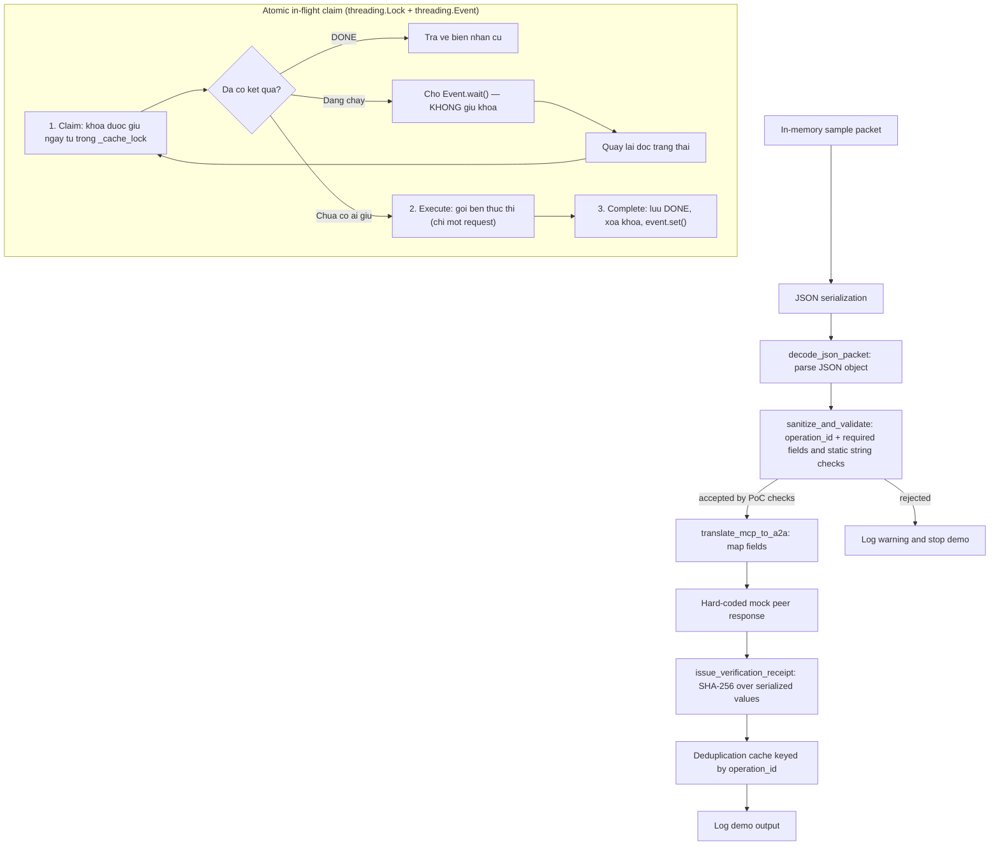

# NAN AI2AI: Kiến trúc PoC lớp bằng chứng kỹ thuật trung lập

## Scope

This document describes the runnable example in `examples/01-hello-agent/hello_bridge.py`. It runs locally with an in-memory sample packet and a hard-coded mock response. It does not connect two agents, expose a network service, or implement a production protocol.

## Implemented data flow

The JSON decoder rejects malformed JSON, non-text input, and top-level JSON values that are not objects. The validator checks a small set of required fields and static string patterns. These checks are illustrative and do not provide security validation. The response is created inside the demo; no remote agent executes the task. The receipt contains a SHA-256 digest that can detect changes to the values hashed, but does not establish who produced them, whether a remote action occurred, or whether the result is trustworthy.

## Conceptual protocol layers

The following terms describe possible future design areas only. They are not implemented protocol layers in this repository:

- **Discovery — conceptual:** no agent registry, capability discovery, or peer lookup exists.
- **Negotiation — conceptual:** no protocol/version negotiation, consent exchange, or task agreement exists.
- **Idempotency & replay protection — implemented (PoC level), sequential AND concurrent:** the atomic in-flight claim (`nan_ai2ai/idempotency.py`) uses a `threading.Lock` to guard every state transition and a `threading.Event` per in-flight `operation_id` so a second request **waits** instead of running the task again. The claim is taken **before** the remote call, which is the only point where it actually prevents double execution — deduplicating only at receipt-issuing time would be too late. See `docs/ADR_003_ATOMIC_IN_FLIGHT_CLAIM.md`. every packet must carry an `operation_id` (idempotency key); `sanitize_and_validate` rejects a packet without it. A **deduplication cache** (`ProtocolBridgeNode._receipt_cache`, and the parallel `_receipt_cache` in `examples/02-agent-to-agent-chat/agent_chat.py`) maps `operation_id` to the receipt already issued, so a retry after a lost ACK returns **the same receipt** instead of executing the task again. `lookup_cached_receipt()` allows the bridge to check **before** invoking the peer, which is what actually prevents double execution — deduplicating only at receipt time would be too late. `nan-receipt/v1` also carries an optional `operation_id` **inside the signed payload**, so the key cannot be swapped without invalidating the signature. **PoC limits:** the cache lives in one process's memory (lost on restart, not shared between nodes, no TTL), and the key is caller-chosen, so reusing a key for two different operations is a caller bug that is detected and logged but not rejected. This is a first step, not production replay protection.
- **Verification — implemented in v0.2 (signed receipt):** `nan_ai2ai/receipt.py` implements the `nan-receipt/v1` receipt. The **executor signs** with Ed25519 (pure-Python RFC 8032); the bridge does **not** sign, so a third party can verify without trusting any intermediary. `kid` is an RFC 7638 JWK thumbprint; the trust anchor is **TOFU** (`nan_ai2ai/trust.py`). No remote execution attestation and no transparency log yet — see `docs/ADR_002_SIGNED_RECEIPT_AND_TRUST_MODEL.md`.

## Current limitations

- No network transport, authentication, authorization, timeouts, or persistent state. Replay protection is **partial**: the deduplication cache is per-process, in memory, and unbounded (no TTL), so it does not survive a restart and is not shared between nodes. A `threading.Lock` guards state **within one process only** — multiple processes or hosts need a distributed lock.
- Static substring checks can miss attacks and can reject benign text; they are not a security boundary.
- No formal JSON Schema, cryptographic signature, key management, or independent test of peer claims.
- The example and its tests demonstrate limited local behavior only. They do not establish production readiness.
- The two bridge implementations (`examples/01-hello-agent/hello_bridge.py` and `examples/02-agent-to-agent-chat/agent_chat.py`) remain **separate** and each keeps its own deduplication cache. Unifying them is tracked as backlog item BL4 in `ROADMAP.md`.
